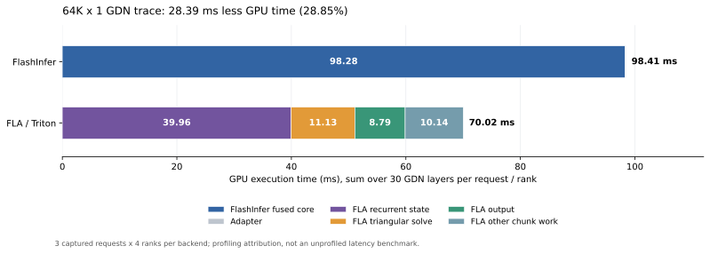

# 64K×1 GDN Nsight Trace 分析

日期：2026-10-13。

## 结论

本轮 trace 中，30 层 GDN 核心算子的 GPU 执行时间从 **98.410 ms** 降至 **70.019 ms**，减少 **28.391 ms（28.85%）**。
这个差值与之前独立、无 profiler 的整模型延迟收益 **28.877 ms** 接近。收益主要落在 GDN 计算本身；两个指标分别是 GPU 算子时间和端到端墙钟时间，不作为严格等式或同轮速度比。
实际 kernel grid 证实：FlashInfer 的这条 SM90 GDN 路径只启动 8 个 block；FLA 将状态更新切成 32 个 block，并将可按时间块独立计算的阶段展开为 8192 或 16384 个 block。这支持此前提出的单长序列并行度解释。

## 实测工作划分

以下 GPU 时间为每请求、每 rank 的 30 层合计，在 3 个请求 × 4 个 rank 上取均值；没有把四张卡的时间相加当成延迟。block 数是一次 kernel launch 的网格规模，不代表全部同时驻留。

| 后端 / 阶段 | GPU 时间 ms | 实测 grid | block 数 |
|---|---:|---|---:|
| FlashInfer 融合核心 | 98.276 | 8×1×1 | 8 |
| FlashInfer 外部 exp / 序列长度类型转换 | 0.134 | 512×1×1 / 1×1×1 | 512 / 1 |
| FLA 状态递推 | 39.956 | 4×8×1 | 32 |
| FLA 三角求解（含结果类型转换） | 11.131 | 主 kernel 1024×8×1 | 8192 |
| FLA 输出计算 | 8.788 | 2×1024×8 | 16384 |
| FLA W/U 重建 | 6.714 | 1024×8×1 | 8192 |
| FLA 块内 KKT | 3.177 | 1024×8×1 | 8192 |
| FLA 门控累计和 | 0.254 | 1024×8×1 | 8192 |

真实输入每 rank：Q/K=[1,65536,4,128]，V=[1,65536,8,128]，BF16；g/beta/initial_state 为 FP32。分块 metadata 包含 1024 个时间块；两后端输入形状、布局和模型配置一致。

## 为什么单条长请求受益

FlashInfer 的融合 GDN 核心使用 grid=(8,1,1)、block=(512,1,1)，每 block 128 registers/thread 和 186368 bytes shared memory。机器每卡有 132 个 SM，但这个具体 kernel 只有 8 个 block，所以同时最多可覆盖 8 个 SM。这是由网格得到的上界，不是实际硬件计数器利用率，更不是整模型 GPU 利用率。
FLA 将能按时间块独立做的工作分成单独阶段，向 GPU 提交大量任务；有递归依赖的状态更新仍沿时间推进，但在 value 维继续分成 4 份，实际 grid=(4,8,1)。其 block=(128,1,1)，150 registers/thread、111112 bytes shared memory。
两个实现都有分块，并非只有 FLA 才把 64K 切成 64-token 块；差别是哪些工作在 block 内顺序推进，哪些作为独立 block 调度。FLA 仍有顺序依赖、额外 kernel launch 和中间张量读写，不能将 8192/8 解读为速度比。
本次 GDN core 范围内未记录 CUDA memcpy 活动；输入 Q/K/V 已连续，g/beta/state 已是 FP32，FlashInfer adapter 的额外 exp 和 cu_seqlens 转换合计仅约 0.134 ms/30 层。大块数据复制不是解释这次约 28 ms 差值的主要因素；CUDA 类型转换本身由 kernel 执行，已计入时间。

## 后续瓶颈

FLA 的状态递推仍占 **39.956 ms，约 57.06%** 的 GDN core GPU 时间，是当前最值得进一步分析的阶段；三角求解约 11.13 ms，其次是输出计算约 8.79 ms。
这次未修改这些 kernel。进一步调整 value 分块、寄存器使用或 pipeline，需要重新评估数值与性能；不能从更大的 grid 直接推断一定更快。

## 采集与归因方法

保持前一轮 PCP：TP4、4×H100 80GB、BF16、eager、FA3、Triton MoE、融合 Norm，固定原 65536-token prompt，每次只生成 1 token。两后端分别启动进程，5 次预热后安装轻量 NVTX 标记，各抓 3 次请求。共 720 个 GDN layer/rank/request 范围全部关联到 GPU 活动；首 token 均为 27775。
Nsight Systems 2025.3.2，capture-range=cudaProfilerApi，CPU sampling 关闭。每个 GDN core、FLA 子阶段、FlashInfer API、请求及部分整模型阶段均有 NVTX；按进程和 CUDA correlation ID 将 GPU 事件关联到提交它的 CPU API，再归入包含该 API 的 NVTX。没有用 CPU NVTX 长度冒充 GPU 时间。
解析 Nsight globalPid 时保留 VM 标识进行 CUDA correlation 匹配，再提取低 24-bit process ID 与 worker rank 对应。每后端 360 个 core 范围、每 rank 每请求 30 层均完整；core GPU 时间之和与区间并集一致，没有重复计算重叠活动。
把每层首个至最后 GPU 活动间的间隙也算入，core 跨度合计为 FlashInfer 98.587 ms / FLA 70.644 ms，减少 27.943 ms。
采集顺序是 FlashInfer → FLA，trace 样本量用于解释执行路径；正式速度结论仍引用此前反向复测、每条件 20 次无 profiler 的基准。trace 不具备 Nsight Compute 的 achieved occupancy、SM active 或内存带宽硬件计数，无法把全部时间差精确归因于单一微架构因素。
两套后端的 logits/recurrent state 已确认存在数值差异；此次首 token 相同不扩大之前的质量验证结论。实验仍未设为生产默认。

## GPU 与复现

启动前持公共 .gpu.lock，并逐次检查所有 GPU 的进程、显存及利用率；忙则拒绝启动。所有任务正常退出并释放 GPU，之后仅在 CPU 上导出和分析。
原始目录：`/vllm-workspace/validation/qwen36_gdn_trace_64k_20261013`。每后端保存 prefill.nsys-rep、prefill.sqlite、result.json、launch.json、源码快照、analysis.json、layers.csv 与 kernels.csv。
测量实现：experiment/pcp-gdn-backend-64k-20261013，c4a888c。抓取脚本仅给 worker 添加临时 NVTX 包装，不修改模型参数或已安装代码。capture.py / trace_case.py / trace_worker.py 采集；analyze.py 归因；report.py 生成本文和图。依赖前一实验的 gpu_guard.py、timing_worker.py 与两个 benchmark Norm helper。
